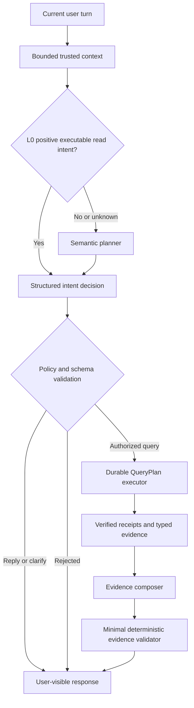

# Group Agent Thin Harness Design and Phased Migration Plan

- Status: Phases 0–1 implemented locally; Phase 1 not deployed; later phases proposed
- Baseline date: 2026-09-16
- Primary repository: `deepagents`
- Primary surface: `apps/group_agent_api` in `group_agent` execution mode

## 1. How to use this document

This document is an execution contract for a staged refactor. It is intentionally
self-contained so that an implementation agent can complete one phase without
inventing the next phase.

The implementation agent MUST follow these rules:

1. Implement only one phase at a time.
2. Stop after the phase acceptance criteria pass.
3. Produce one focused commit for the phase.
4. Do not deploy or change production flags unless separately authorized.
5. Submit the phase for review before starting the next phase.
6. Preserve unrelated working-tree changes and untracked files.
7. Do not weaken authorization, budgets, idempotency, ACK, receipts, durable
   recovery, or callback ordering in the name of making the harness thinner.

This proposal does not freeze or otherwise change the status of `INTENT-000`.
Any contract-freeze decision remains separate.

## 2. Executive decision

The harness should be made thinner by removing duplicated semantic judgment,
not by removing reliable execution controls.

The target ownership model is:

- One semantic authority decides what the user means.
- One policy authority decides whether the requested action is allowed.
- One durable executor decides how an allowed query is performed.
- One evidence authority decides what facts are available to the response.
- One response model decides how those facts are explained to the user.

L0 becomes a positive-only, high-precision fast path. Failure to match L0 is
unknown, not proof of conversation. All non-positive and ambiguous cases move to
the semantic model layer.

The end state is not unrestricted model tool calling. The model owns semantic
decisions; the server continues to own authorization and execution.

## 3. Motivating incident

The production conversation that exposed the problem contained this request:

```text
Can you help me do a search
```

The surrounding conversation had already established that the user was looking
for an experienced restaurant operations person in Shanghai. The observed path
was:

1. L0 did not recognize the English word `search`.
2. L0 returned `conversation` with `no_business_action` at high confidence.
3. The resolver treated that result as authoritative and skipped the semantic
   classifier.
4. No QueryPlan ran: `search_called=false` and
   `server_query_plan_completed=false`.
5. The response model correctly understood the request and drafted a promise to
   search.
6. `intent_final_guard` correctly rejected that unbacked future promise as
   `future_execution_promise`.

The guard behaved according to its contract. The root error occurred earlier:
absence of an L0 keyword match was incorrectly treated as positive evidence that
the turn was only conversation.

The same episode also demonstrated a second failure mode. `Why not a search` was
again routed as conversation. The response model then proposed unsupported
search categories, the grounding layer rejected them as `unsupported_claim`,
and the system returned a generic safe fallback. Neither turn performed a
search.

## 4. Current architecture and excess thickness

The current path contains several components that can independently reinterpret
the same user intent:

```text
signals
  -> resolver/classifier
  -> policy
  -> semantic parameter construction
  -> QueryPlan executor
  -> composing model
  -> reply-grounding model and rewrites
  -> intent final guard
  -> projection filtering
```

The individual components have valid local purposes, but the combined system
allows multiple layers to disagree about:

- whether a query was requested;
- which resource the user meant;
- whether prior constraints should be inherited;
- which results satisfy semantic requirements;
- whether the answer sufficiently displays those results.

This creates false negatives, generic fallbacks, additional latency, and code
that is difficult to reason about as a whole.

## 5. Goals

1. Let the model be the default authority for multilingual, contextual semantic
   intent.
2. Retain a deterministic fast path for explicit, high-confidence read intents.
3. Preserve server ownership of permissions, budgets, QueryPlan execution,
   receipts, ACK, retries, and recovery.
4. Ensure no response can claim a query or external action without current-turn
   verified evidence.
5. Reduce duplicate model judgments and overlapping fallback layers.
6. Preserve the current Deep-to-Micro callback contract and iOS projection
   contract unless a later phase explicitly changes them.
7. Make every phase independently reviewable and reversible.

## 6. Non-goals

1. Do not give the composing model unrestricted network tools.
2. Do not let the model decide authorization, rollout eligibility, budget, or
   callback policy.
3. Do not remove durable queue or execution-store behavior.
4. Do not change callback event ordering:
   `tool_started -> tool_completed -> final`.
5. Do not remove receipt validation.
6. Do not rewrite Micro or iOS during the early Deep-only phases.
7. Do not optimize prompts or personality unrelated to intent routing.

## 7. Design principles

### 7.1 Absence of an L0 match is unknown

L0 may confirm a search only when it has positive evidence. It may not classify a
turn as conversation merely because a phrase was not found.

### 7.2 One layer owns each decision

| Question | Sole authority |
| --- | --- |
| What does the user mean? | Semantic planner |
| Is the action allowed? | Deterministic policy |
| How is the query executed? | Durable executor |
| What data was actually returned? | Receipts and typed evidence |
| How should the answer be written? | Evidence composer |

Downstream layers may validate their own contracts but must not silently redo an
upstream semantic decision.

### 7.3 Model proposes; server disposes

The model may propose an intent, resource, constraints, and response. The server
validates all executable fields against closed schemas and trusted capability
state before any public request.

### 7.4 Fail closed at execution boundaries

Classifier or planner failure must not trigger a query. Timeout, unavailable
models, invalid schemas, ambiguous top candidates, and missing objects resolve
to clarification or safe conversation.

### 7.5 Explicit negation is a hard veto

Phrases such as `不要搜索`, `先别查`, or their supported semantic equivalents
must not be converted into an execute action by a downstream model. Negation is
a policy constraint, not merely a classifier hint.

## 8. Target architecture



### 8.1 Expected model-call count

- Explicit L0 query: query execution plus one evidence-composition call.
- Ambiguous or multilingual query: one planning call, query execution, then one
  evidence-composition call.
- Ordinary conversation or clarification in the eventual end state: one planner
  call that may also provide the direct reply.

Phase 1 does not yet combine planning and ordinary response generation. That
optimization belongs to later phases.

## 9. Security and reliability invariants

Every phase must preserve these invariants.

### 9.1 Authorization

- Only trusted server state supplies `execution_mode`, user identity, search
  capability, surface eligibility, and allowlist membership.
- Model output cannot grant permissions.
- A read intent in a disallowed mode must not execute.

### 9.2 Request control

- Only registered resources and plans may execute.
- Model output cannot provide arbitrary URLs, callback URLs, headers, secrets,
  skill paths, or tool names.
- Query parameters must pass closed-schema validation and length limits.
- Budget reservation occurs before public requests.

### 9.3 Durability

- ACK remains fail closed.
- Idempotency, receipt ledger, attempt fencing, checkpoint recovery, and retry
  behavior remain server-owned.
- No phase may reintroduce model-driven duplicate tool retries.

### 9.4 Evidence

- A query-completed claim requires verified current-turn receipts.
- An external-action claim requires the appropriate external-action receipt.
- Entity IDs shown to the user must originate in current verified evidence.
- Untrusted evidence text cannot override prompts or execution policy.

### 9.5 Callback and client compatibility

- Callback schemas and event ordering remain unchanged in Phases 0 through 2.
- Existing iOS clients must continue to render final replies and candidate cards.
- Projection payload changes require an explicit later-phase compatibility plan.

## 10. Phased implementation plan

Each phase below is a separate review boundary. The implementation agent must not
start a later phase while an earlier phase is awaiting review.

---

## Phase 0: Freeze behavioral evidence and observability

### Objective

Create regression evidence for current correct and incorrect behavior before
changing routing semantics.

### Runtime behavior

No production behavior change.

### Required work

1. Add deterministic unit coverage for:
   - explicit Chinese people search;
   - explicit English search with a prior structured target;
   - generic English search with no target;
   - ordinary English and Chinese conversation;
   - explicit search negation;
   - elliptical follow-up after a completed query;
   - classifier timeout, invalid output, and unavailability.
2. Capture the motivating production sequence as a sanitized fixture or
   equivalent unit-test scenario. Do not copy credentials or raw private profile
   data.
3. Assert routing diagnostics, including:
   - decision source;
   - classifier status and attempts;
   - context inheritance;
   - action;
   - whether a QueryPlan would run.
4. Add or confirm a metric/log distinction between:
   - L0 positive fast path;
   - semantic planner decision;
   - clarification fallback;
   - policy rejection.

### Likely files

- `tests/unit_tests/group_agent_api/test_intent_routing.py`
- `tests/unit_tests/group_agent_api/test_intent_query_plan.py`
- `apps/group_agent_api/agent_factory/intent_routing/resolver.py` only if
  observability needs a behavior-neutral field

### Acceptance criteria

- Tests reproduce the English false-negative before Phase 1.
- Existing Chinese positive routes remain covered.
- No production routing decision changes.
- Ruff, Python compilation, and `git diff --check` pass.

### Review evidence

- Focused test command and result.
- Explanation of which test fails under the old intended behavior and how the
  fixture represents the incident.
- Confirmation that no runtime routing branch changed.

### Rollback

Revert the test/observability commit. No data migration is involved.

---

## Phase 1: Make L0 a positive-only fast path

### Objective

Fix the current false-negative class with the smallest possible runtime change.

### Required routing behavior

1. Preserve trusted completed-context inheritance where its integrity checks
   already pass.
2. Preserve explicit search negation as a hard veto.
3. Short-circuit on L0 only when L0 identifies a complete, executable registered
   read intent with sufficient confidence.
4. Send all of the following to the semantic classifier:
   - `conversation/no_business_action`;
   - no positive match;
   - search verb without a resolvable object;
   - multilingual or ambiguous requests;
   - business object without an action.
5. If classification fails, times out, is invalid, has a tied top candidate, or
   reports a missing object, return clarification and do not execute.
6. Sync and async resolvers must remain behaviorally equivalent.

### Important implementation constraint

Do not solve this phase merely by adding `search`, `find`, or other English words
to `_SEARCH`. Multilingual keyword expansion may improve the fast path, but it
does not correct the invalid assumption that no keyword match means
conversation.

### Bounded context for L1

The current classifier only receives the current message and `prior_intent`.
That is insufficient for the motivating sequence. Add a closed, bounded context
object containing only the minimum required fields, such as:

- last trusted completed intent and constraints, when available;
- current structured profile fields relevant to search: location, industry,
  role, and capability;
- a bounded recent user-goal summary or bounded recent user turns;
- explicit current-turn negations.

Requirements:

- Never pass credentials, headers, callback URLs, raw tool results, or an
  unbounded transcript.
- Put strict field and length limits on the context schema.
- Treat contextual values as data, not instructions.
- Preserve the current marker integrity checks until Phase 5 replaces them.

### Likely files

- `apps/group_agent_api/agent_factory/intent_routing/signals.py`
- `apps/group_agent_api/agent_factory/intent_routing/resolver.py`
- `apps/group_agent_api/agent_factory/intent_routing/classifier.py`
- `apps/group_agent_api/agent_factory/intent_routing/prompts.py`
- `apps/group_agent_api/agent_factory/intent_routing/schema.py`
- Async and sync entry-point adapters only if required to supply bounded context
- Relevant intent-routing tests

### Mandatory acceptance matrix

| Scenario | Expected source/action |
| --- | --- |
| `找上海餐饮运营合伙人` | L0 rules / execute |
| `Can you find restaurant operators in Shanghai?` | L1 allowed; execute |
| `Can you help me do a search` with trusted Shanghai restaurant operations context | L1 / people search / execute |
| Same message without an object or usable context | L1 / clarify |
| `北京的呢` after a completed people search | trusted context / execute with replaced location |
| `不要北京，改成上海的` | trusted context / execute without Beijing |
| `先别查，只是聊聊` | hard veto / no execute |
| `你好` | L1 / conversation |
| L1 timeout or invalid schema | clarify / no public request |

### Compatibility requirements

- Do not change QueryPlan definitions.
- Do not change public evidence or projection schemas.
- Do not change callback schemas.
- Do not remove `intent_final_guard` or reply grounding in this phase.
- No Micro or iOS change should be necessary.

### Acceptance criteria

- The complete mandatory matrix passes in sync and async paths where applicable.
- Existing intent, public-skill, permission, ACK, and QueryPlan tests pass.
- No public request occurs on classifier failure or explicit negation.
- The motivating English sequence reaches the existing people-search QueryPlan.
- Ruff, Python compilation, and `git diff --check` pass.

### Review evidence

- Decision traces for the motivating English request before and after.
- Proof that the classifier is not called for explicit L0 positive search.
- Proof that classifier failure cannot execute.
- Test counts and exact commands.
- No deployment and no production flag changes unless separately authorized.

### Rollback

Revert the Phase 1 commit. Existing QueryPlan and client contracts are unchanged.

---

## Phase 2A: Introduce a structured semantic planner in shadow mode

### Objective

Replace intent-only L1 classification with a richer closed planner contract,
without allowing the new planner to control production execution yet.

### Proposed planner output

The exact versioned schema should be finalized during this phase, but it should
remain conceptually bounded to:

```json
{
  "version": 1,
  "action": "query",
  "intent": "people_search",
  "resource": "users",
  "constraints": {
    "location": ["上海"],
    "industry": ["餐饮"],
    "role": ["运营负责人"],
    "capability": []
  },
  "preferences": [],
  "missing_fields": [],
  "evidence_spans": ["do a search"]
}
```

Allowed actions should be closed, for example:

- `query`
- `clarify`
- `reply`

The planner must not output URLs, credentials, raw query strings, callback
settings, budgets, receipt IDs, or arbitrary tool names.

### Shadow behavior

- Existing Phase 1 decisions remain authoritative.
- Run the planner only where bounded latency and rollout settings permit.
- Record bounded comparison data, never raw sensitive messages.
- Do not execute from a shadow-only planner result.

### Comparison dimensions

- selected action;
- selected intent/resource;
- normalized constraints;
- missing-object decision;
- expected QueryPlan ID;
- latency and status;
- disagreement category.

### Likely files

- New versioned planner schema under `intent_routing`
- Planner prompt/model adapter
- Resolver shadow integration
- Debug-trace or metrics integration
- Planner contract and adversarial tests

### Acceptance criteria

- Planner outputs are closed-schema validated.
- Invalid or injected fields are rejected.
- Shadow results never execute tools.
- No raw prompt, transcript, credentials, or evidence payload is logged.
- A representative multilingual evaluation set shows acceptable agreement and
  explains intentional disagreements with Phase 1.
- Existing runtime behavior remains unchanged.

### Review evidence

- Schema and threat-model review.
- Shadow comparison summary by scenario, not only aggregate accuracy.
- Latency distribution and timeout rate.
- Examples of disagreement classes and proposed handling.

### Rollback

Disable the shadow call and revert the Phase 2A commit. No execution or data
migration dependency is allowed.

---

## Phase 2B: Make the semantic planner authoritative

### Objective

Use the planner as the sole semantic authority for cases not resolved by the L0
positive fast path or hard negation veto.

### Required behavior

- L0 positive read intents continue to bypass the planner.
- All other semantic routing uses the planner result.
- Deterministic policy still maps only registered intent/resource combinations
  to execution.
- Missing fields produce clarification.
- Planner failure produces clarification, never execution.
- Planner constraints remain proposals until policy/schema validation succeeds.

### Rollout

Use explicit observe/enforce gating with a fast rollback path. Do not silently
change the meaning of the existing intent-routing rollout flag. If a new flag is
necessary, document its default, accepted values, and interaction with current
flags.

Recommended progression:

1. allowlisted test users;
2. prod3 scripted conversations;
3. bounded canary;
4. broader enforcement after review.

### Acceptance criteria

- Phase 2A disagreement classes are resolved or explicitly accepted.
- Query execution parity holds for the existing frozen intent set.
- Authorization and no-public-request failure tests remain green.
- Production can immediately revert to Phase 1 behavior through configuration.
- Callback and client schemas remain unchanged.

### Review evidence

- Before/after route distribution.
- False-positive query and false-negative query samples.
- Planner failure and timeout behavior.
- Canary rollback demonstration.

### Rollback

Switch authority back to Phase 1 routing and retain planner shadow telemetry.

---

## Phase 3: Simplify semantic parameter construction and QueryPlan wiring

### Objective

Remove duplicated semantic interpretation between the planner and
`plan_executor`, while retaining deterministic execution.

### Target boundary

The planner owns semantic fields:

- intent;
- resource;
- required constraints;
- preferences;
- missing information.

The server owns mechanical fields:

- registered plan and step IDs;
- pagination;
- per-step and total budgets;
- parameter encoding;
- timezone conversion from a trusted timezone;
- ACK and progress events;
- receipts, ledger, fences, attempts, retries, and recovery.

### Required work

1. Define a single normalization step from validated planner constraints to
   registered resource parameters.
2. Remove only semantic heuristics proven redundant by planner output.
3. Preserve deterministic handling for values that must not be guessed, such as
   event IDs and trusted timezone boundaries.
4. Preserve fairness across active plan steps before pagination.
5. Preserve preflight validation before public requests.

### Do not remove

- QueryPlan registry;
- skill and plan contract validation;
- budgets;
- receipt ledger;
- ACK;
- fences;
- min-success conditions;
- cross-attempt recovery.

### Acceptance criteria

- Existing public-skill integration tests remain green.
- Identical validated planner input produces deterministic resource parameters.
- Negated values never reappear in a query.
- Timezone boundary tests remain explicit.
- Multi-step budget fairness remains covered.
- No client schema change is required.

### Review evidence

- Inventory of deleted heuristics and the planner fields replacing each one.
- Golden parameter vectors before and after.
- Proof that public requests cannot occur before validation and ACK.

### Rollback

Keep the old parameter adapter behind a temporary internal switch until parity is
accepted, then remove the switch in a separate reviewed cleanup commit.

---

## Phase 4: Replace overlapping response guards with typed evidence references

### Objective

Stop using multiple semantic judges to infer whether prose is grounded. Make the
composer cite typed current-turn evidence and validate those references
deterministically.

### Proposed composer output

```json
{
  "answer": "找到两位公开资料相关的人选……",
  "referenced_receipt_ids": ["receipt-1"],
  "referenced_entities": [
    {
      "resource": "users",
      "entity_id": "123",
      "fields": ["name", "location", "industry"]
    }
  ]
}
```

The schema must be closed and bounded. IDs and fields must be verified against
current-turn typed evidence.

### Deterministic validator responsibilities

- referenced receipts exist and belong to the current execution;
- referenced entity IDs exist in the current evidence;
- referenced fields exist on that entity;
- an external-action claim has an action receipt;
- a profile-saved claim has a persistence receipt;
- a query-completed claim has valid query receipts;
- a final reply cannot promise a nonexistent background task.

### Components to evaluate for consolidation

- LLM reply-grounding retries;
- entity-name extraction from prose;
- overlapping `execution_result_omitted` heuristics;
- portions of `intent_final_guard` covered by typed references;
- duplicate projection filtering.

Do not delete these components until typed-output parity and fallback behavior
have been reviewed. Introduce typed composition in shadow or dual-validation mode
first.

### Client compatibility

Prefer deriving the existing Micro/iOS projection payload from typed evidence so
that no client change is required. If a payload change is unavoidable, it must be
specified as a separate compatibility subphase with Micro and iOS tests.

### Acceptance criteria

- Invented entity IDs and fields fail closed.
- Valid evidence references pass without an additional LLM judge.
- Malicious evidence text cannot add references or override instructions.
- Large evidence remains globally bounded and valid JSON.
- Existing public answer and candidate-card tests remain green.
- Measured response latency improves or does not materially regress.

### Review evidence

- Dual-validation comparison between old grounding and typed validation.
- False-accept and false-reject examples.
- Explicit list of old checks proposed for deletion.
- Latency and model-call-count comparison.

### Rollback

Return to the old composer and guard path while retaining typed-output logs only
if they contain no sensitive raw payloads.

---

## Phase 5: Simplify durable context and remove obsolete code

### Objective

Replace inference from message-embedded context markers with explicit structured
checkpoint state, then delete obsolete compatibility layers.

### Proposed durable state

```json
{
  "version": 1,
  "thread_id": "...",
  "user_id": "...",
  "execution_mode": "group_agent",
  "episode_id": "...",
  "last_completed_intent": "people_search",
  "constraints": {},
  "receipt_ids": [],
  "answer_committed": true,
  "completed_at": "..."
}
```

The state must be bound to the same scope currently protected by marker hashes.
It must not become available for inheritance until the successful final answer
is durably committed.

### Migration approach

1. Dual-write explicit state and existing markers.
2. Compare restored context from both sources.
3. Prefer explicit state for allowlisted traffic.
4. Prove failure, retry, and episode-isolation behavior.
5. Stop writing markers.
6. Remove marker scanning in a separate cleanup commit.

### Cleanup inventory

After parity is proven, identify and remove:

- obsolete semantic regexes;
- old classifier-only schemas and prompts;
- redundant grounding rewrites;
- duplicate projection matchers;
- message-marker recovery code;
- temporary rollout switches and shadow comparison code.

Deletion must follow evidence. Do not delete a component merely because a later
component appears to cover it.

### Acceptance criteria

- Context never crosses user, thread, mode, conversation, or episode scope.
- Failed composition cannot publish inheritable context.
- Late callbacks and old attempts cannot overwrite current context.
- Three-turn positive and negative follow-up regressions pass.
- Dual-read comparison shows parity before marker removal.
- Final code and flags have a documented single owner for each invariant.

### Review evidence

- State transition table for success, failure, retry, and episode reset.
- Dual-read parity report.
- Exact deletion inventory.
- Recovery tests using real checkpoint behavior rather than duplicated test logic.

### Rollback

During dual-write, return reads to existing markers. Marker removal is permitted
only after an explicit review gate and must have its own reversible commit.

## 11. Cross-repository impact by phase

| Phase | Deep | Micro | iOS |
| --- | --- | --- | --- |
| 0 | Tests/observability | None | None |
| 1 | Resolver/classifier/context | None | None |
| 2A | Shadow planner | None | None |
| 2B | Planner authority | None if callback schemas stay stable | None |
| 3 | Planner-to-executor normalization | None | None |
| 4 | Typed composition and projection derivation | Possibly projection compatibility tests | Possibly only if payload changes |
| 5 | Checkpoint context and cleanup | Only if state ownership moves across service boundary | None expected |

No implementation agent may introduce a Micro or iOS change merely for
convenience during a Deep-only phase.

## 12. Test strategy

### 12.1 Routing tests

Cover Chinese and English, explicit and implicit requests, positive and negative
follow-ups, and classifier failures. Assert both the decision and absence or
presence of public requests.

### 12.2 QueryPlan tests

Assert deterministic parameters, budget fairness, ACK-before-fetch, receipt
validity, min-success conditions, and resume behavior.

### 12.3 Evidence tests

Use typed malicious fixtures, including oversized valid JSON, injected
instructions, nested names, unsupported claims, invalid entity references, and
cross-receipt attempts.

### 12.4 Context tests

Cover scope mismatch, hash/state tampering, failed composing, a later human turn,
episode reset, account change, execution-mode switch, and late attempt callback.

### 12.5 End-to-end scripted conversation

Every phase that changes behavior must preserve or intentionally update this
scripted scenario:

1. `I need to find someone for a different idea.`
2. `The new idea is about opening a new kind of restaurant in a busy area in Shanghai.`
3. `I need someone experienced in operation.`
4. `Can you help me do a search?`

Expected final behavior after Phase 1:

- the final turn does not resolve as `no_business_action`;
- the semantic layer uses the bounded Shanghai/restaurant/operations context;
- a people-search QueryPlan executes when context is sufficient;
- progress ordering remains correct;
- the final response is based on current receipts;
- no future-execution fallback is shown.

Also test the same final request without the prior three turns. It must clarify
the search object and must not issue a public request.

## 13. Observability and evaluation

Track at least:

- routing source: context, L0, planner, fallback;
- planner status and attempts;
- action distribution;
- L0-to-planner disagreement;
- planner-to-observed-route disagreement;
- query execution rate;
- clarification rate;
- policy rejection rate;
- future-promise guard rate;
- grounding abandonment rate;
- planner and total turn latency;
- public-request count per turn;
- duplicate receipt or retry anomalies.

Logs must remain bounded and must not contain credentials, authorization headers,
raw private profiles, or full public evidence payloads.

Success should not be judged only by aggregate agreement. Review false-positive
queries and false-negative queries separately because their operational risks
are different.

## 14. Phase review template

The implementation agent must provide the following after every phase:

```text
Phase:
Commit:
Behavior changed:
Behavior intentionally unchanged:
Files changed:
Feature/rollout flags:
Focused tests:
Broader regressions:
Ruff / compile / diff-check:
Known blockers:
Production changes made: none / explicitly listed
Next phase started: no
```

The review should answer:

1. Did the phase stay within scope?
2. Did semantic authority move as intended without weakening execution controls?
3. Can any failure path issue a public request unexpectedly?
4. Are sync and async paths equivalent?
5. Are logs and checkpoints free of sensitive unbounded content?
6. Are existing callback and client contracts preserved?
7. Is rollback immediate and tested?
8. Is the next phase still independently optional?

## 15. Stop conditions

The implementation agent must stop and request direction if any phase would
require:

- changing a public callback schema earlier than Phase 4;
- weakening receipt validation;
- allowing arbitrary model-generated tool names, URLs, or query parameters;
- removing ACK or attempt fencing;
- changing Micro or iOS during a Deep-only phase;
- migrating or deleting production data;
- freezing `INTENT-000`;
- combining multiple phases into one commit;
- deploying or changing production flags without explicit authorization.

## 16. Final desired outcome

At the end of the migration, the system should be understandable as three
primary components:

1. Semantic planner: understands the user and proposes reply, clarification, or
   a structured read request.
2. Policy plus durable executor: validates and reliably executes allowed work.
3. Evidence composer plus minimal validator: explains only verified results.

The harness is thin when it stops repeatedly reinterpreting language. It remains
strong where deterministic guarantees are required: authorization, execution,
durability, and evidence provenance.

## 17. Implementation progress (2026-09-16)

This section records implementation state; the phase contracts above remain the
source of truth for later work. `INTENT-000` is still not frozen.

| Phase | Status | Evidence |
| --- | --- | --- |
| 0 | Complete | `9fa8c311` froze routing evidence; `726fafa5` restored public construction compatibility and separated semantic clarification from classifier failure. No routing behavior changed. |
| 1 | Implemented and locally verified; not deployed | `42369e6c` changed L0 `no_business_action` from conversation to unknown, allowing bounded L1 classification. Follow-up fixes `25d127e2`, `2eb9e783`, `0c16acd5`, `0d7b8a5f`, and the code committed with this progress update aligned classification with frozen query constraints, added bilingual aliases and exclusions, and fixed query/projection edge cases. |
| 2A–5 | Not started | No planner-authority change, callback-schema change, Micro/iOS change, or production rollout has been made for these phases. |

Phase 1's current behavior:

- A complete positive L0 read can execute without calling L1; unknown or
  ambiguous turns reach L1. Explicit search negation remains a hard veto.
- L1 receives bounded prior-turn, completed-intent, and structured profile
  context. Classifier failure or an unresolved search object clarifies without
  issuing a public request. Sync and async entry points use the same resolver
  semantics.
- The server freezes positive constraints and explicit exclusions before the
  existing QueryPlan runs. English aliases use controlled Chinese canonical
  values; candidate projection accepts equivalent aliases without treating
  `ai` inside `Shanghai` as an AI-industry match.
- Query parameter cleanup removes recognized exclusion phrases without erasing
  unrelated text. Candidate location matching uses an explicit `city` before
  broader location/address fields, so a Shanghai address on Beijing West Road
  is not mistaken for a Beijing candidate.

Local verification for the final Phase 1 working tree: 202 group-agent API unit
tests passed with the pre-existing `test_anonymous.py` exclusion; targeted Ruff
and `git diff --check` passed. The motivating English search, classifier failure,
Chinese receipt projection, profile exclusions, exclusion-prefix query cleanup,
and city-versus-street cases have regression coverage. These are local checks,
not evidence of a prod3 rollout or live simulator acceptance.

Deployment and Phase 2A remain separate review gates. Before rollout, confirm
the deployed SHA and flags, replay the four-turn motivating conversation and
explicit-negation cases against the target environment, and inspect receipt,
candidate, and progress ordering. Do not begin Phase 2A merely because Phase 1
unit tests pass.
