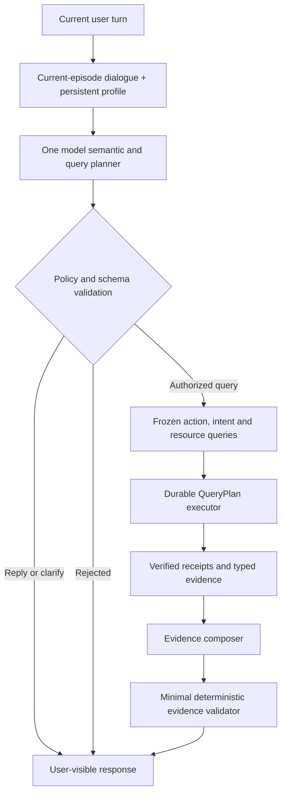

# Group Agent Thin Harness Design and Phased Migration Plan

- Status: Phases 0–2 are historical/local implementation milestones; Phases 3–4
  below remain the next proposal boundaries, not yet authorized for
  implementation or deployment
- Baseline date: 2026-09-16
- Design revision: 2026-09-17 — model-owned query formulation from conversation
  and profile; supersedes the original L0-fast-path end state
- Phase 2 local implementation: 2026-09-17 — authoritative planner cutover
- Primary repository: `deepagents`
- Primary surface: `apps/group_agent_api` in `group_agent` execution mode

## 1. How to use this document

This document is an execution contract for a staged refactor. It is intentionally
self-contained so that an implementation agent can complete one phase without
inventing the next phase.

The implementation agent MUST follow these rules:

1. Implement only one phase at a time.
2. Stop after the phase acceptance criteria pass.
3. Produce one focused commit for the phase.
4. Do not deploy or change production flags unless separately authorized.
5. Submit the phase for review before starting the next phase.
6. Preserve unrelated working-tree changes and untracked files.
7. Do not weaken authorization, budgets, idempotency, ACK, receipts, durable
   recovery, or callback ordering in the name of making the harness thinner.

This proposal does not freeze or otherwise change the status of `INTENT-000`.
Any contract-freeze decision remains separate.

Phases 0–1 document what was implemented and why. The 2026-09-17 decision
changes the **target** for Phase 2 onward: no semantic keyword fast path or
lexicon-based query construction remains in the end state. Where historical
Phase 0–1 acceptance criteria mention L0, they are not requirements for the
revised end state.

## 2. Executive decision

The harness should be made thinner by removing duplicated semantic judgment,
not by removing reliable execution controls.

The target ownership model is:

- One semantic authority decides what the user means.
- One policy authority decides whether the requested action is allowed.
- One durable executor decides how an allowed query is performed.
- One evidence authority decides what facts are available to the response.
- One response model decides how those facts are explained to the user.

The model becomes the sole semantic authority on **every turn**, including
explicit search, elliptical follow-up, conversation, and clarification. It
reads the current-episode conversation (both human and assistant turns) and the
persistent user profile, then proposes the action, registered intent, and
resource-appropriate search query. L0 keyword rules and industry/role/location
lexicons are historical Phase 1 mechanisms, not the target design.

The end state is not unrestricted model tool calling. The model owns semantic
decisions and query wording; the server continues to own authorization,
registered plans, execution, and evidence provenance.

## 3. Motivating incident

The production conversation that exposed the problem contained this request:

```text
Can you help me do a search
```

The surrounding conversation had already established that the user was looking
for an experienced restaurant operations person in Shanghai. The observed path
was:

1. L0 did not recognize the English word `search`.
2. L0 returned `conversation` with `no_business_action` at high confidence.
3. The resolver treated that result as authoritative and skipped the semantic
   classifier.
4. No QueryPlan ran: `search_called=false` and
   `server_query_plan_completed=false`.
5. The response model correctly understood the request and drafted a promise to
   search.
6. `intent_final_guard` correctly rejected that unbacked future promise as
   `future_execution_promise`.

The guard behaved according to its contract. The root error occurred earlier:
absence of an L0 keyword match was incorrectly treated as positive evidence that
the turn was only conversation.

The same episode also demonstrated a second failure mode. `Why not a search` was
again routed as conversation. The response model then proposed unsupported
search categories, the grounding layer rejected them as `unsupported_claim`,
and the system returned a generic safe fallback. Neither turn performed a
search.

## 4. Current architecture and excess thickness

The current path contains several components that can independently reinterpret
the same user intent:

```text
signals
  -> resolver/classifier
  -> policy
  -> semantic parameter construction
  -> QueryPlan executor
  -> composing model
  -> reply-grounding model and rewrites
  -> intent final guard
  -> projection filtering
```

The individual components have valid local purposes, but the combined system
allows multiple layers to disagree about:

- whether a query was requested;
- which resource the user meant;
- whether prior constraints should be inherited;
- which profile and conversation details belong in the search query;
- which results satisfy semantic requirements;
- whether the answer sufficiently displays those results.

This creates false negatives, generic fallbacks, additional latency, and code
that is difficult to reason about as a whole.

## 5. Goals

1. Let the model be the default authority for multilingual, contextual semantic
   intent.
2. Remove semantic L0 fast paths and lexicon-based query assembly from the
   target path; explicit requests also go through the model planner.
3. Preserve server ownership of permissions, budgets, QueryPlan execution,
   receipts, ACK, retries, and recovery.
4. Ensure no response can claim a query or external action without current-turn
   verified evidence.
5. Reduce duplicate model judgments and overlapping fallback layers.
6. Preserve the current Deep-to-Micro callback contract and iOS projection
   contract unless a later phase explicitly changes them.
7. Make every phase independently reviewable and reversible.
8. Use the full retained current-episode conversation, including prior assistant
   replies, and persistent `doing`/`need`/`offer` profile text when formulating
   a query. Do not silently reduce this to the latest message or five user turns.

## 6. Non-goals

1. Do not give the composing model unrestricted network tools.
2. Do not let the model decide authorization, rollout eligibility, budget, or
   callback policy.
3. Do not remove durable queue or execution-store behavior.
4. Do not change callback event ordering:
   `tool_started -> tool_completed -> final`.
5. Do not remove receipt validation.
6. Do not rewrite Micro or iOS during the early Deep-only phases.
7. Do not optimize prompts or personality unrelated to intent routing.

## 7. Design principles

### 7.1 Semantic interpretation belongs to the model

No semantic keyword hit, alias, or regex may settle whether a turn is a search
or what its query should say. Phase 2 removes the Phase 1 L0 runtime path
directly; it does not retain a parallel routing switch.

### 7.2 One layer owns each decision

| Question | Sole authority |
| --- | --- |
| What does the user mean? | Semantic planner |
| Is the action allowed? | Deterministic policy |
| How is the query executed? | Durable executor |
| What data was actually returned? | Receipts and typed evidence |
| How should the answer be written? | Evidence composer |

Downstream layers may validate their own contracts but must not silently redo an
upstream semantic decision.

### 7.3 Model proposes; server disposes

The model may propose an action, registered intent, resource-specific query,
and response. The server validates executable shape, resource membership, query
length, and trusted capability state before any public request. It must not
re-interpret industry, location, role, or negation with another semantic
lexicon after the model has decided.

### 7.4 Fail closed at execution boundaries

Classifier or planner failure must not trigger a query. Timeout, unavailable
models, invalid schemas, ambiguous top candidates, and missing objects resolve
to clarification or safe conversation.

### 7.5 Current instructions outrank historical context

The planner must understand statements such as `不要搜索` or `不要北京` semantically,
without an enumerated veto phrase list. It must prefer the current user's
explicit direction over older turns and profile defaults. A `reply` or
`clarify` decision cannot be converted into a query by downstream code.
Authorization and resource restrictions remain deterministic policy, not
semantic keyword rules.

### 7.6 Conversation and profile provenance

- Supply the complete retained **current-episode** human and assistant history
  in order, plus persistent profile `doing`/`need`/`offer` and any explicit
  `match_constraints`. Assistant replies explain conversational references but
  are not verified facts about users or external entities.
- A new episode deliberately has no prior-episode checkpoint transcript; its
  persistent profile remains available. Reading older episode transcripts is a
  separate scope decision, not an implicit part of this revision.
- If the retained history exceeds the model context window, use an explicit,
  provenance-bound compression of older turns plus recent turns verbatim.
  Record that compression occurred; never silently take only the last message
  or last five user turns. Do not include credentials, raw tool results, or
  internal prompts as conversation content.

## 8. Target architecture



### 8.1 Expected model-call count

- Every turn: one planning call. A search then uses the registered QueryPlan
  and one evidence-composition call; reply/clarification may be produced by the
  planner without a second model judgment.

Phase 1 did not combine planning and ordinary response generation. That
historical implementation is a rollback baseline, not the revised target.

## 9. Security and reliability invariants

Every phase must preserve these invariants.

### 9.1 Authorization

- Only trusted server state supplies `execution_mode`, user identity, search
  capability, surface eligibility, and allowlist membership.
- Model output cannot grant permissions.
- A read intent in a disallowed mode must not execute.

### 9.2 Request control

- Only registered resources and plans may execute.
- Model output cannot provide arbitrary URLs, callback URLs, headers, secrets,
  skill paths, or tool names.
- Query parameters must pass closed-schema validation and length limits.
- Budget reservation occurs before public requests.

### 9.3 Durability

- ACK remains fail closed.
- Idempotency, receipt ledger, attempt fencing, checkpoint recovery, and retry
  behavior remain server-owned.
- No phase may reintroduce model-driven duplicate tool retries.

### 9.4 Evidence

- A query-completed claim requires verified current-turn receipts.
- An external-action claim requires the appropriate external-action receipt.
- Entity IDs shown to the user must originate in current verified evidence.
- Untrusted evidence text cannot override prompts or execution policy.

### 9.5 Callback and client compatibility

- Callback schemas and event ordering remain unchanged in Phases 0 through 2.
- Existing iOS clients must continue to render final replies and candidate cards.
- Projection payload changes require an explicit later-phase compatibility plan.

## 10. Phased implementation plan

Each phase below is a separate review boundary. The implementation agent must not
start a later phase while an earlier phase is awaiting review.

---

## Phase 0: Freeze behavioral evidence and observability

### Objective

Create regression evidence for current correct and incorrect behavior before
changing routing semantics.

### Runtime behavior

No production behavior change.

### Required work

1. Add deterministic unit coverage for:
   - explicit Chinese people search;
   - explicit English search with a prior structured target;
   - generic English search with no target;
   - ordinary English and Chinese conversation;
   - explicit search negation;
   - elliptical follow-up after a completed query;
   - classifier timeout, invalid output, and unavailability.
2. Capture the motivating production sequence as a sanitized fixture or
   equivalent unit-test scenario. Do not copy credentials or raw private profile
   data.
3. Assert routing diagnostics, including:
   - decision source;
   - classifier status and attempts;
   - context inheritance;
   - action;
   - whether a QueryPlan would run.
4. Add or confirm a metric/log distinction between:
   - L0 positive fast path;
   - semantic planner decision;
   - clarification fallback;
   - policy rejection.

### Likely files

- `tests/unit_tests/group_agent_api/test_intent_routing.py`
- `tests/unit_tests/group_agent_api/test_intent_query_plan.py`
- `apps/group_agent_api/agent_factory/intent_routing/resolver.py` only if
  observability needs a behavior-neutral field

### Acceptance criteria

- Tests reproduce the English false-negative before Phase 1.
- Existing Chinese positive routes remain covered.
- No production routing decision changes.
- Ruff, Python compilation, and `git diff --check` pass.

### Review evidence

- Focused test command and result.
- Explanation of which test fails under the old intended behavior and how the
  fixture represents the incident.
- Confirmation that no runtime routing branch changed.

### Rollback

Revert the test/observability commit. No data migration is involved.

---

## Phase 1: Make L0 a positive-only fast path

### Objective

Fix the current false-negative class with the smallest possible runtime change.

### Required routing behavior

1. Preserve trusted completed-context inheritance where its integrity checks
   already pass.
2. Preserve explicit search negation as a hard veto.
3. Short-circuit on L0 only when L0 identifies a complete, executable registered
   read intent with sufficient confidence.
4. Send all of the following to the semantic classifier:
   - `conversation/no_business_action`;
   - no positive match;
   - search verb without a resolvable object;
   - multilingual or ambiguous requests;
   - business object without an action.
5. If classification fails, times out, is invalid, has a tied top candidate, or
   reports a missing object, return clarification and do not execute.
6. Sync and async resolvers must remain behaviorally equivalent.

### Important implementation constraint

Do not solve this phase merely by adding `search`, `find`, or other English words
to `_SEARCH`. Multilingual keyword expansion may improve the fast path, but it
does not correct the invalid assumption that no keyword match means
conversation.

### Bounded context for L1

The current classifier only receives the current message and `prior_intent`.
That is insufficient for the motivating sequence. Add a closed, bounded context
object containing only the minimum required fields, such as:

- last trusted completed intent and constraints, when available;
- current structured profile fields relevant to search: location, industry,
  role, and capability;
- a bounded recent user-goal summary or bounded recent user turns;
- explicit current-turn negations.

Requirements:

- Never pass credentials, headers, callback URLs, raw tool results, or an
  unbounded transcript.
- Put strict field and length limits on the context schema.
- Treat contextual values as data, not instructions.
- Preserve the current marker integrity checks until Phase 4 replaces them.

### Likely files

- `apps/group_agent_api/agent_factory/intent_routing/signals.py`
- `apps/group_agent_api/agent_factory/intent_routing/resolver.py`
- `apps/group_agent_api/agent_factory/intent_routing/classifier.py`
- `apps/group_agent_api/agent_factory/intent_routing/prompts.py`
- `apps/group_agent_api/agent_factory/intent_routing/schema.py`
- Async and sync entry-point adapters only if required to supply bounded context
- Relevant intent-routing tests

### Mandatory acceptance matrix

| Scenario | Expected source/action |
| --- | --- |
| `找上海餐饮运营合伙人` | L0 rules / execute |
| `Can you find restaurant operators in Shanghai?` | L1 allowed; execute |
| `Can you help me do a search` with trusted Shanghai restaurant operations context | L1 / people search / execute |
| Same message without an object or usable context | L1 / clarify |
| `北京的呢` after a completed people search | trusted context / execute with replaced location |
| `不要北京，改成上海的` | trusted context / execute without Beijing |
| `先别查，只是聊聊` | hard veto / no execute |
| `你好` | L1 / conversation |
| L1 timeout or invalid schema | clarify / no public request |

### Compatibility requirements

- Do not change QueryPlan definitions.
- Do not change public evidence or projection schemas.
- Do not change callback schemas.
- Do not remove `intent_final_guard` or reply grounding in this phase.
- No Micro or iOS change should be necessary.

### Acceptance criteria

- The complete mandatory matrix passes in sync and async paths where applicable.
- Existing intent, public-skill, permission, ACK, and QueryPlan tests pass.
- No public request occurs on classifier failure or explicit negation.
- The motivating English sequence reaches the existing people-search QueryPlan.
- Ruff, Python compilation, and `git diff --check` pass.

### Review evidence

- Decision traces for the motivating English request before and after.
- Proof that the classifier is not called for explicit L0 positive search.
- Proof that classifier failure cannot execute.
- Test counts and exact commands.
- No deployment and no production flag changes unless separately authorized.

### Rollback

Revert the Phase 1 commit. Existing QueryPlan and client contracts are unchanged.

---

## Phase 2: Replace semantic routing and query construction in one change

### Objective

Replace intent-only L1 classification, L0 semantic fast paths, fixed synonym
lexicons, and server-side semantic query assembly with one authoritative model
planner. This is one implementation/review phase, not shadow, canary, or
observe/enforce rollout stages. The planner runs on every turn, including
obvious search requests and ordinary conversation.

Its input includes the current turn, the retained current-episode human and
assistant conversation, and the persistent profile (including legacy free-text
`doing`, `need`, and `offer`, not just `match_constraints`). Long history needs
explicit, tested compression or rehydration; silently keeping only the last
five user turns is not acceptable. Prior assistant replies are conversational
context, not trusted factual evidence.

### Proposed planner output

Finalize a closed, versioned schema in this phase. Its query action is
conceptually:

```json
{
  "version": 2,
  "action": "query",
  "intent": "people_search",
  "queries": {"users": "上海 餐饮 运营合伙人"},
  "clarification": null
}
```

Allowed actions should be closed, for example:

- `query`
- `clarify`
- `reply`

The planner **does** output semantic search text for each selected registered
read resource. It must not output URLs, credentials, headers, callback settings,
budgets, receipt IDs, arbitrary tool names, or arbitrary parameter keys. Define
resource-specific fields, length bounds, and non-text parameter handling in the
schema. No fixed bilingual lexicon or industry-specific rules may manufacture
missing semantic terms after the planner responds.

### Required work

1. Supply the full retained current-episode conversation and persistent profile
   as bounded, provenance-marked data. Exclude credentials, raw tool results,
   and internal prompts. Explicitly handle context-window overflow.
2. Use one planner result for every turn. Current instructions override older
   turns and profile defaults. Missing search objects or planner failure produce
   clarification; no public request occurs.
3. Validate action, registered intent/resource, query size and shape,
   authorization, and plan contract before execution. Freeze the accepted
   action, intent, resource-specific queries, context identity, and planner
   version in a versioned routing snapshot before any public request. Retry
   reuses that snapshot instead of regenerating a query.
4. Adapt validated query text mechanically to registered resource parameters
   (`q`, `keyword`, and other allowed fields). Keep deterministic handling for
   trusted timezone boundaries and event IDs; never guess them.
5. Remove L0 search fast paths, the old classifier-only path, fixed synonym
   lexicons, and semantic query builders such as `_semantic_query` and
   `_people_query` in the same change. Do not retain dual routing, shadow calls,
   observe/enforce flags, or a temporary old-query adapter.
6. Keep the QueryPlan registry, skill and plan preflight, permissions, budgets,
   step fairness, ACK-before-fetch, receipts, fences, min-success conditions,
   retry, and recovery unchanged in ownership and behavior.
7. Keep old snapshots readable **only if** an in-flight run can still resume
   during deployment. Otherwise drain or finish those runs before cutover. Do
   not build a permanent dual-path compatibility framework for unused beta
   traffic or migrate/delete user data as part of this phase.

Query text may contain private profile details. Store it in the protected
execution snapshot and explicitly contracted bounded debugging surfaces, not
unrestricted application logs. Planner failure must never silently fall back to
latest-message-only query construction.

### Likely files

- Versioned planner schema, prompt/model adapter, and resolver
- Sync and async entry points and profile/conversation context loader
- Routing snapshot and mechanical `plan_executor` parameter adapter
- Deletion of old semantic routing, lexicon, and query assembly code
- Planner, QueryPlan, failure, retry, and conversation regressions

### Acceptance criteria

- Every turn uses the planner in sync and async paths; no L0/lexicon semantic
  decision path remains.
- Invalid/injected output, timeout, and missing object cause clarification with
  no public request. Explicit `不要搜索` does not execute.
- A multilingual, multi-industry evaluation set checks query relevance from
  current request, full available episode history, and legacy profile text.
- Identical frozen planner output yields identical request parameters; retry
  does not call the planner again for the same execution.
- Public-skill, authorization, budget fairness, ACK, receipt, fence, recovery,
  and callback tests pass. No callback or client schema change is required.
- No raw prompt, full transcript, credentials, or evidence payload is logged.

### Review evidence

- Schema and threat-model review; query examples across industries and
  corrections, including the new-episode restaurant/profile incident.
- Planner failure/timeout, context-overflow, and snapshot/retry traces.
- Exact inventory of removed semantic rules and proof of no request before
  validation and ACK.
- Focused and broader test commands/results, latency distribution, and
  confirmation that no deployment/flag change occurred.

### Rollback

Revert the focused Phase 2 code commit before deployment, or redeploy the prior
image if a beta deployment fails. Do not maintain the old routing path in the
new runtime solely for rollback. Check and finish or safely cancel in-flight
runs before switching images; never discard a durable execution silently.

---

## Phase 3: Replace overlapping response guards with typed evidence references

### Objective

Stop using multiple semantic judges to infer whether prose is grounded. Make the
composer cite typed current-turn evidence and validate those references
deterministically.

### Proposed composer output

```json
{
  "answer": "找到两位公开资料相关的人选……",
  "referenced_receipt_ids": ["receipt-1"],
  "referenced_entities": [
    {
      "resource": "users",
      "entity_id": "123",
      "fields": ["name", "location", "industry"]
    }
  ]
}
```

The schema must be closed and bounded. IDs and fields must be verified against
current-turn typed evidence.

### Deterministic validator responsibilities

- referenced receipts exist and belong to the current execution;
- referenced entity IDs exist in the current evidence;
- referenced fields exist on that entity;
- an external-action claim has an action receipt;
- a profile-saved claim has a persistence receipt;
- a query-completed claim has valid query receipts;
- a final reply cannot promise a nonexistent background task.

### Components to evaluate for consolidation

- LLM reply-grounding retries;
- entity-name extraction from prose;
- overlapping `execution_result_omitted` heuristics;
- portions of `intent_final_guard` covered by typed references;
- duplicate projection filtering.

Replace the overlapping checks in one focused change after Phase 2 is reviewed.
Use adversarial and existing response fixtures to prove each invariant before
deleting its old implementation; no shadow composer or dual-validation runtime
is required for beta traffic.

### Client compatibility

Prefer deriving the existing Micro/iOS projection payload from typed evidence so
that no client change is required. If a payload change is unavoidable, pause
for an explicit cross-repository review and compatibility tests.

### Acceptance criteria

- Invented entity IDs and fields fail closed.
- Valid evidence references pass without an additional LLM judge.
- Malicious evidence text cannot add references or override instructions.
- Large evidence remains globally bounded and valid JSON.
- Existing public answer and candidate-card tests remain green.
- Measured response latency improves or does not materially regress.

### Review evidence

- Fixture-based comparison between old grounding and typed validation.
- False-accept and false-reject examples.
- Explicit list of old checks proposed for deletion.
- Latency and model-call-count comparison.

### Rollback

Revert the focused code commit or redeploy the prior image. Do not keep a
permanent dual-composer path for rollback.

---

## Phase 4: Simplify durable context and remove obsolete code

### Objective

Replace inference from message-embedded context markers with explicit structured
checkpoint state, then delete obsolete compatibility layers.

### Proposed durable state

```json
{
  "version": 1,
  "thread_id": "...",
  "user_id": "...",
  "execution_mode": "group_agent",
  "episode_id": "...",
  "last_completed_intent": "people_search",
  "constraints": {},
  "receipt_ids": [],
  "answer_committed": true,
  "completed_at": "..."
}
```

The state must be bound to the same scope currently protected by marker hashes.
It must not become available for inheritance until the successful final answer
is durably committed.

### Implementation approach

1. Write explicit state when the final answer is durably committed.
2. Read that state for subsequent turns and remove marker scanning/writing in
   the same reviewed change; prove failure, retry, and episode isolation with
   real checkpoint tests.
3. Before deployment, identify unfinished runs or checkpoints that could still
   need old markers. Drain/finish them or provide a narrowly scoped reader for
   those exact snapshots; do not introduce ongoing dual-write or allowlist
   migration for beta traffic. Do not delete historical conversations or other
   user data.

### Cleanup inventory

Within this phase, identify and remove remaining obsolete code:

- obsolete semantic regexes;
- old classifier-only schemas and prompts;
- redundant grounding rewrites;
- duplicate projection matchers;
- message-marker recovery code;
- obsolete rollout switches, if no active caller requires them.

Deletion must follow evidence. Do not delete a component merely because a later
component appears to cover it.

### Acceptance criteria

- Context never crosses user, thread, mode, conversation, or episode scope.
- Failed composition cannot publish inheritable context.
- Late callbacks and old attempts cannot overwrite current context.
- Three-turn positive and negative follow-up regressions pass.
- Existing completed checkpoints and in-flight runs have a documented safe
  cutover; no user conversation data is deleted.
- Final code and flags have a documented single owner for each invariant.

### Review evidence

- State transition table for success, failure, retry, and episode reset.
- Checkpoint cutover inventory and targeted recovery tests.
- Exact deletion inventory.
- Recovery tests using real checkpoint behavior rather than duplicated test logic.

### Rollback

Revert the focused code commit or redeploy the prior image after safely
handling in-flight runs. Do not maintain ongoing marker dual-write solely for
rollback.

## 11. Cross-repository impact by phase

| Phase | Deep | Micro | iOS |
| --- | --- | --- | --- |
| 0 | Tests/observability | None | None |
| 1 | Resolver/classifier/context | None | None |
| 2 | Authoritative planner, query adapter/snapshot, old semantic-rule deletion | None if callback schemas stay stable | None |
| 3 | Typed composition and projection derivation | Possibly projection compatibility tests | Possibly only if payload changes |
| 4 | Checkpoint context and cleanup | Only if state ownership moves across service boundary | None expected |

No implementation agent may introduce a Micro or iOS change merely for
convenience during a Deep-only phase.

## 12. Test strategy

### 12.1 Routing tests

Cover Chinese and English, varied industries and paraphrases, explicit and
implicit requests, positive and negative follow-ups, full retained episode
history, persistent profile, and planner failures. Assert action, selected
resource, query content, and absence or presence of public requests. Do not
make a finite keyword list the acceptance oracle.

### 12.2 QueryPlan tests

Assert deterministic parameters from the frozen query snapshot, budget fairness,
ACK-before-fetch, receipt validity, min-success conditions, and resume behavior.

### 12.3 Evidence tests

Use typed malicious fixtures, including oversized valid JSON, injected
instructions, nested names, unsupported claims, invalid entity references, and
cross-receipt attempts.

### 12.4 Context tests

Cover scope mismatch, hash/state tampering, failed composing, a later human turn,
episode reset, account change, execution-mode switch, and late attempt callback.

### 12.5 End-to-end scripted conversation

Every phase that changes behavior must preserve or intentionally update this
scripted scenario:

1. `I need to find someone for a different idea.`
2. `The new idea is about opening a new kind of restaurant in a busy area in Shanghai.`
3. `I need someone experienced in operation.`
4. `Can you help me do a search?`

Expected behavior after Phase 1 (historical acceptance):

- the final turn does not resolve as `no_business_action`;
- the semantic layer uses the bounded Shanghai/restaurant/operations context;
- a people-search QueryPlan executes when context is sufficient;
- progress ordering remains correct;
- the final response is based on current receipts;
- no future-execution fallback is shown.

Also test the same final request without the prior three turns. It must clarify
the search object and must not issue a public request.

For Phase 2 implementation and review, add these cases:

- A new episode starts with `继续搜索`: retained history is empty, but a legacy
  persistent profile containing restaurant, Shanghai, and operations context
  still informs a relevant search query when the object is sufficiently clear;
  otherwise the planner asks a precise clarification.
- A new episode starts with `搜索上海的运营合伙人`: profile free text mentions a
  restaurant business while structured `match_constraints` is empty. The
  `users` query includes the restaurant industry context; it is not built only
  from the latest message.
- Earlier user and assistant turns establish an industry or object, followed by
  a short correction such as `全职` or `不要北京，改成上海的`. The planner uses the
  conversation and current correction, without reviving superseded details.
- Equivalent scenarios across different industries and Chinese/English wording
  pass without adding vocabulary-specific code.
- A new episode does not inherit the old episode's raw conversation or
  completed-intent marker. Persistent profile remains available under its own
  user/mode scope.
- Planner timeout, malformed output, or context overflow does not trigger a
  latest-message-only fallback or public fetch. Long context is explicitly
  compressed/rehydrated or fails closed with an observable reason.
- On retry, the same accepted query and routing snapshot are reused; no second
  model call silently changes search semantics.

## 13. Observability and evaluation

Track at least:

- routing source: authoritative planner or failure fallback;
- planner status and attempts;
- action distribution;
- offline query-quality results and representative failure categories;
- query execution rate;
- clarification rate;
- policy rejection rate;
- future-promise guard rate;
- grounding abandonment rate;
- planner and total turn latency;
- query semantic-completeness evaluation, with sanitized examples and bounded
  query fingerprints rather than raw private profile or full transcript logs;
- context source/coverage (current episode, profile, explicit compression) and
  overflow/failure rates;
- routing-snapshot version and retry-query consistency;
- public-request count per turn;
- duplicate receipt or retry anomalies.

Logs must remain bounded and must not contain credentials, authorization headers,
raw private profiles, or full public evidence payloads.

Success should not be judged only by aggregate agreement. Review false-positive
queries and false-negative queries separately because their operational risks
are different.

## 14. Phase review template

The implementation agent must provide the following after every phase:

```text
Phase:
Commit:
Behavior changed:
Behavior intentionally unchanged:
Files changed:
Feature/rollout flags:
Focused tests:
Broader regressions:
Ruff / compile / diff-check:
Known blockers:
Production changes made: none / explicitly listed
Next phase started: no
```

The review should answer:

1. Did the phase stay within scope?
2. Did semantic authority move as intended without weakening execution controls?
3. Can any failure path issue a public request unexpectedly?
4. Are sync and async paths equivalent?
5. Are logs and checkpoints free of sensitive unbounded content?
6. Are existing callback and client contracts preserved?
7. Is rollback immediate and tested?
8. Is the next phase still independently optional?

## 15. Stop conditions

The implementation agent must stop and request direction if any phase would
require:

- changing a public callback schema without a separate compatibility review;
- weakening receipt validation;
- allowing arbitrary model-generated tool names, URLs, or parameter keys outside
  the closed registered resource schema (validated search-query values are
  intentionally model-generated);
- removing ACK or attempt fencing;
- changing Micro or iOS during a Deep-only phase;
- migrating or deleting production data;
- freezing `INTENT-000`;
- combining multiple phases into one commit;
- deploying or changing production flags without explicit authorization.

## 16. Final desired outcome

At the end of the migration, the system should be understandable as three
primary components:

1. Semantic planner: reads the current request, current-episode conversation,
   and persistent profile; chooses reply, clarification, or a registered read,
   and writes its resource-specific search query.
2. Policy plus durable executor: validates and reliably executes allowed work.
3. Evidence composer plus minimal validator: explains only verified results.

The harness is thin when it stops repeatedly reinterpreting language. It remains
strong where deterministic guarantees are required: authorization, execution,
durability, and evidence provenance.

## 17. Implementation progress (2026-09-16)

This section records the historical 2026-09-16 implementation snapshot. The
revised Phase 2–4 contracts above govern future work; this snapshot is not a
claim about the current deployment. `INTENT-000` was not frozen at this point.

| Phase | Status | Evidence |
| --- | --- | --- |
| 0 | Complete | `9fa8c311` froze routing evidence; `726fafa5` restored public construction compatibility and separated semantic clarification from classifier failure. No routing behavior changed. |
| 1 | Implemented and locally verified; not deployed | `42369e6c` changed L0 `no_business_action` from conversation to unknown, allowing bounded L1 classification. Follow-up fixes `25d127e2`, `2eb9e783`, `0c16acd5`, `0d7b8a5f`, and the code committed with this progress update aligned classification with frozen query constraints, added bilingual aliases and exclusions, and fixed query/projection edge cases. |
| 2 | Implemented and locally verified; not deployed | Authoritative `PlannerProposalV2` on every turn; frozen `resource_queries` in `IntentDecisionV1` / routing snapshot; mechanical QueryPlan parameter adapter; L0 semantic fast path, classifier-only path, and `_semantic_query` / `_people_query` lexicon assembly removed. Sync/async entry points pass full episode history plus persistent `doing`/`need`/`offer`. No callback/client schema change; no production flag change. |
| 3–4 | Not started | Typed evidence composer and durable checkpoint context remain separate phases. |

Phase 1's current behavior:

- A complete positive L0 read can execute without calling L1; unknown or
  ambiguous turns reach L1. Explicit search negation remains a hard veto.
- L1 receives bounded prior-turn, completed-intent, and structured profile
  context. Classifier failure or an unresolved search object clarifies without
  issuing a public request. Sync and async entry points use the same resolver
  semantics.
- The server freezes positive constraints and explicit exclusions before the
  existing QueryPlan runs. English aliases use controlled Chinese canonical
  values; candidate projection accepts equivalent aliases without treating
  `ai` inside `Shanghai` as an AI-industry match.
- Query parameter cleanup removes recognized exclusion phrases without erasing
  unrelated text. Candidate location matching uses an explicit `city` before
  broader location/address fields, so a Shanghai address on Beijing West Road
  is not mistaken for a Beijing candidate.

Local verification for the final Phase 1 working tree: 202 group-agent API unit
tests passed with the pre-existing `test_anonymous.py` exclusion; targeted Ruff
and `git diff --check` passed. The motivating English search, classifier failure,
Chinese receipt projection, profile exclusions, exclusion-prefix query cleanup,
and city-versus-street cases have regression coverage. These are local checks,
not evidence of a prod3 rollout or live simulator acceptance.

## 18. Design revision and next implementation gate (2026-09-17)

The current incident exposes a semantic ownership gap: a fresh episode may
still have a useful persistent profile, but the existing routing context mostly
projects structured `match_constraints` and recent user turns. A legacy profile
can describe a restaurant business in free text while `match_constraints` is
empty. A short request such as `全职` or `搜索上海的运营合伙人` can then yield a query
without the restaurant context. Adding another restaurant synonym or regex
would only repair one example and keep semantic decisions split across layers.

The revised direction is to remove the eventual L0/lexicon semantic fast path
and use one model planner on every turn. It must see the current request, the
retained full current-episode conversation (both sides), and persistent profile
fields including legacy free text. It returns a closed action, registered
intent/resource, and resource-specific search query. The server validates and
freezes that proposal, then executes the existing durable QueryPlan; it does
not reinterpret the business meaning or append terms using a keyword list.

“Full conversation” means all retained messages in the **current episode**,
subject to an explicit context-window strategy. It does not silently merge raw
messages from a previous episode. The profile persists across episodes, while
old conversation must be deliberately summarized into profile/memory if it is
meant to survive reset. Assistant messages inform conversational references
but cannot serve as independent factual evidence for results or authorization.

This is a design update only: no code, flag, deployment, or callback/client
schema change is authorized by this document edit. Because the agent is still
in internal beta, Phase 2 directly introduces the authoritative planner,
query construction, versioned snapshot, and deletion of redundant rules in one
reviewable change. It does not require shadow evaluation, staged authority,
canary flags, or a second cleanup phase. Phase 3 independently simplifies
response guards; Phase 4 independently simplifies durable context. Each phase
still needs tests and review, and deployment remains separately authorized.
The historical Phase 0–1 commits and their behavior are recorded above, not
retroactively rewritten as if this revision had already shipped.
